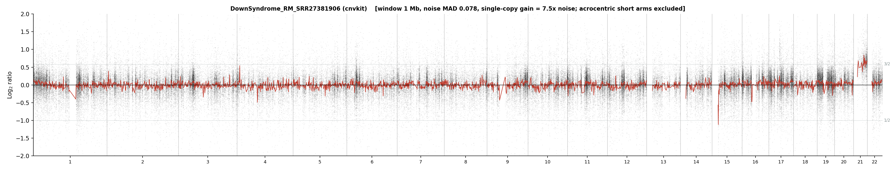
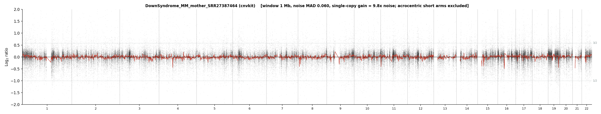
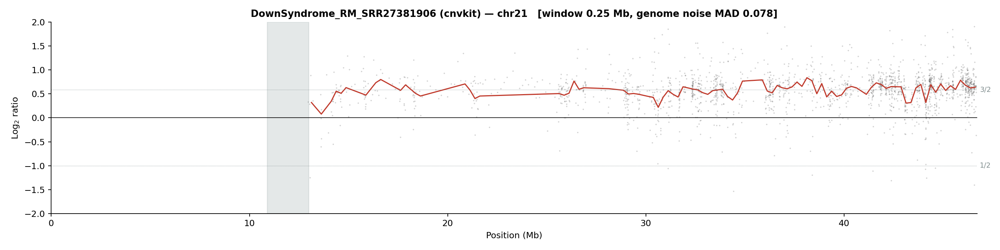
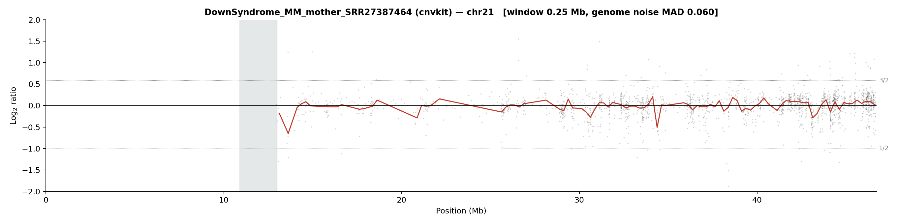

<div align="center">

# cnvkaryo

**A virtual karyogram from sequencing depth.**

From WES or WGS — FASTQ or BAM — it reports whole-chromosome aneuploidy,
arm and segment level gains and losses, homozygous deletions and focal
amplifications, as auditable tables alongside the plots a cytogeneticist
would read.

[](LICENSE)
[](https://snakemake.readthedocs.io)
[](https://doi.org/10.5281/zenodo.23738890)
[](CITATION.cff)

</div>

---

## It works. Here is the proof.

A constitutional **trisomy 21** case and its matched control, run through the
pipeline with identical settings.

<div align="center">

<br><em><b>Case.</b> Chromosome 21 sits one step above every other chromosome.</em>
<br><br>

<br><em><b>Control.</b> The same pipeline, the same settings: everything flat.</em>
</div>

<div align="center">


<br><em>Chromosome 21 on its own — case on the left, control on the right. The
gain spans the whole chromosome, which is what a trisomy looks like in read
depth: a ratio near 1.5, three copies against a two-copy baseline.</em>
</div>

A negative control that stays flat matters as much as a positive case that
lights up. A caller that finds the trisomy but also finds six other things is
not working.

---

## Scope — and what read depth cannot do

cnvkaryo measures **copy number**: whole-chromosome aneuploidy and arm or
segment level gains and losses.

It does **not** detect balanced rearrangements — reciprocal translocations and
inversions carry no read-depth signal, so no coverage-based method can see
them, this one included. Nor does it detect copy-neutral loss of
heterozygosity, or parent of origin.

The breakpoints table flags where copy number changes, which is the most that
is honest to claim from this kind of data. Deciding whether a boundary is a
balanced translocation needs orthogonal evidence: FISH, karyotyping, or
long reads.

Stating this plainly is not modesty. A tool that implies it replaces
cytogenetics will be trusted where it should not be.

---

## What it produces

| Output | Content |
|---|---|
| `tables/*_chromosome_calls.tsv` | per-chromosome call with the ratio behind it |
| `tables/*_arm_calls.tsv` | arm-level imbalance, amplitude and extent |
| `tables/*_breakpoints.tsv` | where copy number changes |
| `ideogram/*_aneuploidy.png` | the karyogram view |
| `karyotype/*_genome.png` | whole-genome trace |
| `chromosomes/chrN.png` | 24 per-chromosome images at full resolution |
| `genes/*_scatter.png` | per-gene plots for a configured gene list |

Three tables, because a call should be auditable: the number, the evidence
that produced it, and where the boundary sits.

---

## Quick start

```bash
git clone https://github.com/brunorsci/cnvkaryov1.git
cd cnvkaryov1
conda env create -f envs/python_analysis.yaml

# reference files: see docs/references.md
cp config/config.yaml config/example.yaml   # then edit the paths

snakemake --configfile config/example.yaml --cores 8 --use-conda
```

**To confirm the installation**, run it on a public sample with a known
answer — a trisomy 21 exome from the SRA. Download instructions and the
expected result are in [`docs/example.md`](docs/example.md). No data ships
with this repository.

---

## Relationship to VKaryo

cnvkaryo is the copy-number module of
[VKaryo](https://github.com/brunorsci/VKaryo), extracted to stand alone
and **DNA-only**: it does not require paired RNA-seq. Use cnvkaryo when copy
number is the question and only DNA is available; use VKaryo when paired
RNA-seq is in hand and fusions, structural variants and point mutations
matter too.

---

## Documentation

| | |
|---|---|
| [`docs/example.md`](docs/example.md) | the example run, with a public sample |
| [`docs/references.md`](docs/references.md) | reference files and how to obtain them |
| [`config/config.yaml`](config/config.yaml) | every option, documented |

## Citing

If you use CNVKaryo, please cite the archived release:
**[10.5281/zenodo.23738890](https://doi.org/10.5281/zenodo.23738890)**

<details>
<summary>BibTeX</summary>

```bibtex
@software{cnvkaryo_2026,
  author    = {Assuncao, Bruno Rodrigo},
  title     = {CNVKaryo: virtual karyotyping from sequencing depth},
  version   = {1.0.0},
  year      = {2026},
  publisher = {Zenodo},
  doi       = {10.5281/zenodo.23738890},
  url       = {https://doi.org/10.5281/zenodo.23738890}
}
```

</details>

## Licence

MIT — see [`LICENSE`](LICENSE).
